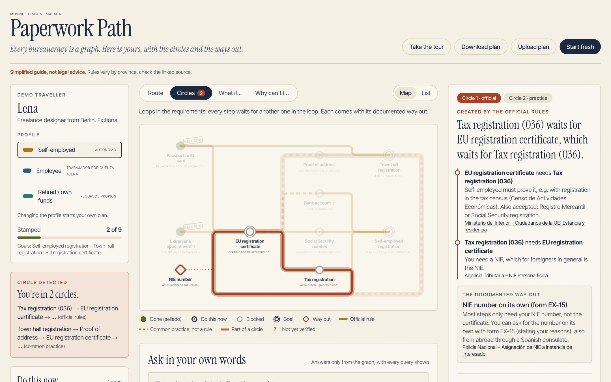
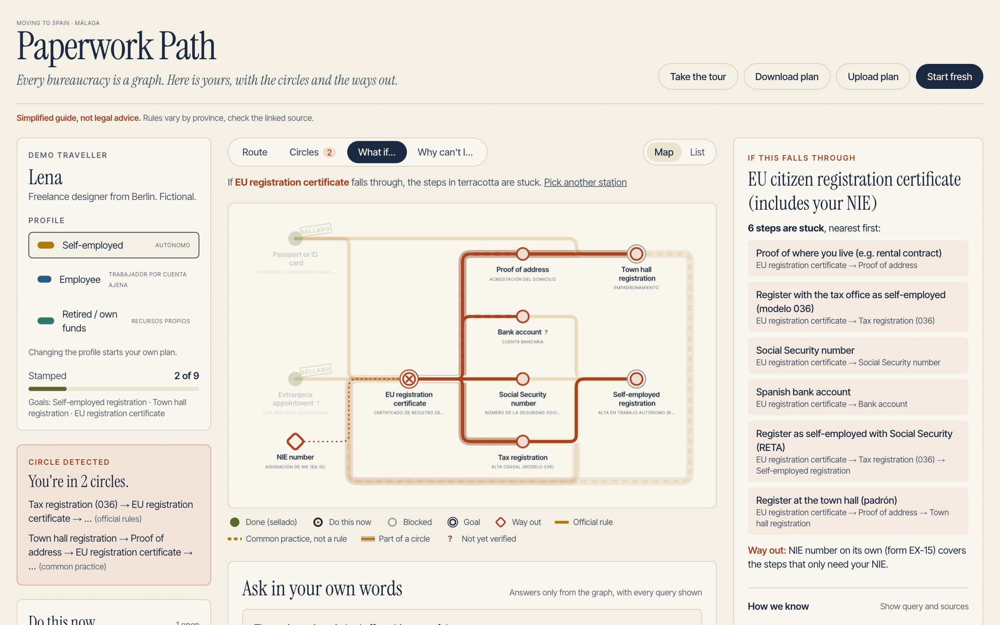
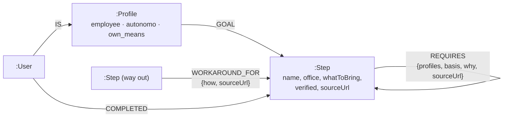

# Paperwork Path

**Every bureaucracy is a graph.** Paperwork Path shows an EU citizen moving to
Málaga, Spain, the right order of steps: residence certificate, town hall
registration, tax and Social Security. It also finds the circles where every
step waits for another, and shows the official way out of each one.

Everything runs on [Relate](https://relatedb.ai), Neo4j's embedded graph
database, inside your browser. No account, no server-side copy of your plan.

**Live demo:** _link added at submission_ · **Video (2 min):** _link added at submission_



> Simplified guide, not legal advice. Rules vary by province; every step links
> to the official page it comes from.

## The problem

Lena is a freelance designer from Berlin (fictional). To register as
self-employed in Spain she needs a residence certificate. The certificate asks
the self-employed for proof of their activity, such as the tax registration.
The tax registration needs a tax number, which for foreigners is the NIE. And
the NIE is printed on the certificate. A circle, created by the official rules
themselves.

Checklists can't show this, because a checklist is a list. The rules are a
graph: steps are nodes, requirements are edges, and a circle is a cycle. Once
the rules are a graph, the hard questions become short queries.

## What it does

| Question | What you get | How (openCypher on Relate) |
|---|---|---|
| **Do this now** | The steps whose every requirement is met | `NOT EXISTS` over unmet `REQUIRES` edges |
| **Circles** | Every loop for your profile, official or common practice, with its documented way out | Variable-length cycle `(s)-[:REQUIRES*2..8]->(s)` |
| **What if…** | Pick a step that might fall through: everything stuck behind it, with the chain | Reverse variable-length paths, `none()` over intermediate nodes |
| **Why can't I…** | For any goal, the shortest chain down to what you still lack, official rules first | Paths ordered by practice-links, then length |
| **Ask in your own words** | Questions in plain English, answered only from the graph | Claude picks from six fixed tools; they run in your browser |

Every answer has a **How we know** panel with the exact Cypher that ran, its
parameters, and the official sources behind the result.



Also: three profiles (employee, self-employed, retired / own funds), a
"Start fresh" plan that saves in your browser, download and upload of your plan
as a readable `.cypher` file, an accessible list view, and a skippable
30-second tour.

## Connected context makes the assistant reliable

The "Ask in your own words" box uses Claude Haiku 5.5, a small, fast model.
On its own, a model answers bureaucracy questions from memory: plausible,
unsourced, sometimes out of date. With the graph it can't do that:

- **Six fixed, typed tools**: the four questions above, `getStep` and
  `listProfiles`. Step ids come from a closed list in the tool schema
  (`strict: true`). The model cannot write Cypher, so it cannot invent a step
  or a requirement.
- **Tools run in your browser** against your own Relate graph. The server
  route is a thin proxy that only holds the API key and forwards one model
  call; it never sees your graph, only the tool results the model asked for.
- **Instructed to answer only from tool results.** If the graph has no answer
  (try "How much does the NIE cost?"; fees are deliberately not in the data),
  it says so instead of guessing.
- **Every tool call is shown**: tool, parameters, the graph path it returned,
  its sources, its Cypher, and a "Show on map" button.
- **A fair side-by-side.** Switch on *Compare* to ask the same question twice:
  same model, same settings, same system prompt (including your profile and
  finished steps). The only difference: the graph side also gets the tools and
  a short note on how to use them. The "without" side is not weakened in any
  way.

Protection for the public demo: a per-IP rate limit and a daily spending cap,
both with a friendly message and the demo video link. Without an API key the
box explains that it's switched off; the rest of the app works fully.

*Privacy: questions to the assistant are sent to Anthropic. Your plan stays in
your browser.*

## The graph



- 14 steps, 3 profiles, every requirement with its source and a `basis`:
  `official` (on an official page) or `practice` (common in real life, not a
  rule; drawn dashed and always labelled).
- `REQUIRES.profiles` is a list property: an empty list means "everyone".
- A requirement is met when you completed it **or** a documented way out of it.

The data lives in [`data/`](data) as readable JSON. Sources are listed below.

## Relate capabilities used

Relate **1.3.0**, pinned exactly in `package.json`:
`@relate/relate-wasm@1.3.0` (browser) and `@relate/relate@1.3.0` (Node).

| Capability | Where |
|---|---|
| Embedded graph database in the browser (WebAssembly) | The whole app: seed, your plan, every query, in your tab |
| openCypher: `CREATE`, `MERGE`, `UNWIND` with parameter lists | Loading the seed and your plan ([seed.ts](src/graph/seed.ts), [plan.ts](src/graph/plan.ts)) |
| Variable-length paths `*0..12`, `*1..12`, cycles `*2..8` | Reachability, what if, why can't I, circles ([queries.ts](src/graph/queries.ts)) |
| List properties on relationships, `IN`, `size()` | Profile-specific requirements |
| `all()`, `none()`, `any()` predicates over path nodes and relationships | "Applies to this profile", "nothing in between is met" |
| `EXISTS { }` and `NOT EXISTS { }` subqueries | "Is this met?", "Can I do this now?" |
| Pattern and list comprehensions, `collect(DISTINCT …)` | Building chains and sources in one query |
| Plan files as openCypher text | Download writes a readable `CREATE` script; upload parses only the ids and rebuilds the plan with parameterised queries, so uploaded text is never executed |
| Native Node client writing a `.rl` file | `npm run mcp:build` |
| MCP server (`relate serve --mcp stdio --read-only`) | Expose the same graph to Claude Desktop or Claude Code ([docs/mcp.md](docs/mcp.md)) |

What we learned about Relate while building is in
[docs/phase-0-spike.md](docs/phase-0-spike.md) (18 checks, all passing).

## Run it

Requires Node 22.18 or newer (the scripts use Node's built-in TypeScript).

```bash
npm install
```

```bash
npm run dev
```

Open http://localhost:3000. The assistant is off until you add a key:

```bash
cp .env.example .env.local
```

Then set `ANTHROPIC_API_KEY` in `.env.local` and restart. Optional settings
(rate limit, daily cap, video link) are explained in
[`.env.example`](.env.example).

### Tests

```bash
npm test
```

42 unit tests on the real Relate engine (WASM in Node): seed integrity,
circles, what if, why can't I, plan files, map layouts, and the assistant's
safety rails (unknown tools and ids rejected, the proxy request fixed on the
server, both comparison modes identical apart from the tools, rate limit and
budget). No model is called.

```bash
npm run test:e2e
```

Playwright smoke test of the judge's path, on desktop and at phone width, in
your installed Chrome. Set `PW_CHANNEL=chromium` to use Playwright's own
browser instead.

### Other scripts

| Command | What it does |
|---|---|
| `npm run mcp:build` | Builds `mcp/paperwork-path.rl` for `relate serve`, and checks seven answers against it |
| `npm run layouts` | Precomputes the metro map layout for each profile with ELK (run after changing `data/`) |
| `npm run review-data` | Prints a review table of the data ([docs/data-review.md](docs/data-review.md)) |

### Deploy to Vercel

Import the repository in Vercel (framework: Next.js, no settings needed).
Optionally add `ANTHROPIC_API_KEY` and `NEXT_PUBLIC_DEMO_VIDEO_URL` as
environment variables.

The rate limit and daily cap are counted in server memory, so on serverless
hosting each instance counts on its own. **Also set a spend limit on the API key
in the Anthropic Console**: that is the hard stop.

## Use the graph over MCP

```bash
npm run mcp:build
```

```bash
relate serve --mcp stdio --database ./mcp/paperwork-path.rl --read-only
```

Config for Claude Desktop and Claude Code, a ready-made circle query, and how
this differs from the in-app assistant: [docs/mcp.md](docs/mcp.md).

## Data and honesty

- Only official sources. Every step and requirement links to the page it comes
  from, checked on 2026-11-27.
- Anything not confirmed on an official page is marked `verified: false`, shown
  with a "?" on the map, and listed in [docs/manual-check.md](docs/manual-check.md)
  (3 steps).
- Common practice is kept apart from rules: 3 `practice` requirements, drawn
  dashed, never used to build "why can't I" chains when an official chain exists.
- No fees, waiting times or deadlines: none were read on an official page, so
  none are in the data.
- The demo traveller, Lena, is fictional. No real personal data anywhere.

Official sources:

- Ministerio del Interior: [Ciudadanos de la UE, estancia y residencia](https://www.interior.gob.es/opencms/es/servicios-al-ciudadano/tramites-y-gestiones/extranjeria/ciudadanos-de-la-union-europea/estancia-y-residencia/)
- Policía Nacional: [Certificado de Registro de Ciudadano de la UE](https://sede.policia.gob.es/portalCiudadano/_es/tramites_extranjeria_tramite_certificadoregistro_ciudadanoue.php) · [Asignación de NIE (EX-15)](https://sede.policia.gob.es/portalCiudadano/_es/tramites_extranjeria_tramite_asignacion_nie.php)
- Migraciones: [Hoja 65](https://inclusion.gob.es/web/migraciones/w/65.-certificado-de-registro-de-ciudadano-de-la-union-europea)
- Sede MPTMD: [Cita previa de extranjería](https://mptmd.sede.gob.es/pagina?id=Extranjeria-cita-previa-extranjeria)
- Ayuntamiento de Málaga: [Padrón de habitantes](https://sede.malaga.eu/sta/CarpetaPublic/doEvent?APP_CODE=STA&PAGE_CODE=CATALOGO&DETALLE=6269000058790046999500)
- Agencia Tributaria: [NIF persona física](https://sede.agenciatributaria.gob.es/Sede/censos-nif-domicilio-fiscal/solicitar-nif/nif-persona-fisica.html) · [Modelo 036](https://sede.agenciatributaria.gob.es/Sede/censos-nif-domicilio-fiscal/tramites-censales-relacionados-empresarios-profesionales-retenedores.html) · [Modelo 036 FAQ](https://sede.agenciatributaria.gob.es/Sede/censos-nif-domicilio-fiscal/tramites-censales-relacionados-empresarios-profesionales-retenedores/preguntas-frecuentes-modelos-036-037.html)
- Seguridad Social (Import@ss): [Número de la Seguridad Social](https://portal.seg-social.gob.es/wps/portal/importass/importass/Categorias/Altas%2C+bajas+y+modificaciones/Altas+y+afiliacion+de+trabajadores/Solicitar+el+numero+de+la+Seguridad+Social) · [Alta en trabajo autónomo](https://portal.seg-social.gob.es/wps/portal/importass/importass/Categorias/Altas%2C+bajas+y+modificaciones/Altas+y+afiliacion+de+trabajadores/Alta_trabajo_autonomo) · [Trabajo autónomo](https://portal.seg-social.gob.es/wps/portal/importass/importass/Colectivos/Trabajo+Autonomo)

## How it's built

```
src/graph/     Relate wrapper, seed loader, the typed queries, plan files (+ tests)
src/agent/     Assistant: tools, prompt, proxy request builder, guard, browser loop (+ tests)
src/app/       Next.js page, layout, and the one server route: api/agent
src/components Metro map (SVG), sidebar, drawer, list view, tour, assistant panel
src/lib/       Graph hook (WASM + localStorage), map layout, precomputed layouts
data/          Steps, requirements, way outs, profiles, sources, demo traveller
scripts/       MCP file builder, layout precompute, data review
e2e/           Playwright smoke test
docs/          Spike report, data review, manual-check list, MCP guide, quality checks
```

Quality checks (Lighthouse, smoke test, contrast): accessibility 100, best
practices 100, SEO 100, performance 85 on desktop. On a simulated slow phone
connection the first visit waits for the 2.4 MB graph engine; details and what
was done about it in [docs/phase-5-checks.md](docs/phase-5-checks.md).

## Third-party tools

| Tool | Version | Use | License |
|---|---|---|---|
| [Relate](https://relatedb.ai) (`@relate/relate-wasm`, `@relate/relate`) | 1.3.0 | Graph database in the browser and in Node, MCP server | Apache-2.0 |
| [Next.js](https://nextjs.org) | 15.5.29 | App framework, one server route | MIT |
| React | 19.1.0 | UI | MIT |
| Tailwind CSS | 4 | Styling | MIT |
| [elkjs](https://github.com/kieler/elkjs) | 0.11.0 | Metro map layout (layered, orthogonal), precomputed at build time | EPL-2.0 |
| [Anthropic TypeScript SDK](https://github.com/anthropics/anthropic-sdk-typescript) | 1.14.0 | Server proxy for the assistant | Apache-2.0 |
| Vitest | 3.2.4 | Unit tests | MIT |
| Playwright | 1.65.1 | Smoke test | Apache-2.0 |
| Lighthouse | 13.6.0 | Quality audit (not a dependency) | Apache-2.0 |
| Instrument Serif, Inter Tight, JetBrains Mono | via `next/font` | Typography | SIL Open Font License |

## AI tools used

- **Claude Code** (Claude Opus 5.5, by Anthropic) built this project with me,
  phase by phase: the Relate spike, the data research (reading the official
  pages), the queries, the UI, the assistant, the tests and these docs. I
  reviewed and approved each phase and the data before the next one started.
- **Claude Haiku 5.5** (by Anthropic) runs inside the app as the "Ask in your
  own words" assistant, only when an API key is configured.

## Trademarks

Relate and Neo4j are trademarks of Neo4j, Inc. They are used here only to
identify the database this project is built on. Paperwork Path is an
independent hackathon project and is not affiliated with, sponsored or
endorsed by Neo4j. Claude and Anthropic are trademarks of Anthropic.

## License

[MIT](LICENSE)
